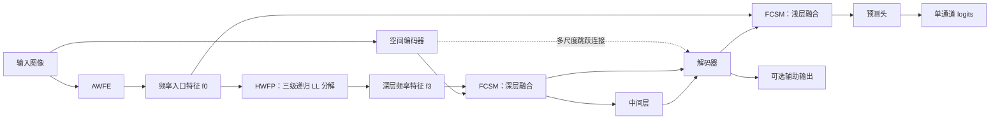

# MSSFNet

**Mamba Spatial–Spectral Fusion Network**，面向红外小目标检测的空间—频率特征融合网络。

本仓库是按照论文模块名称整理的代码版本，包含模型、训练与测试入口、预测图生成、历史权重兼容工具及整理前后的一致性验证脚本。整理保留原有网络运算、参数初始化顺序和训练配置，并将模块命名统一为 **MSSFNet、AWFE、HWFP、MSDA、FCSM、CSA**。

仓库提供模型代码和验证脚本；**数据集、预训练权重和原始版本代码需另行准备**。当前没有新增训练结果或完整数据集性能报告。

## 1. 模块与论文名称对应

| 模块 | 论文名称 | 原代码名称 | 当前实现 |
| --- | --- | --- | --- |
| MSSFNet | Mamba Spatial–Spectral Fusion Network | `HDNet` | [model/MSSFNet.py](model/MSSFNet.py) |
| AWFE | Adaptive Wavelet Frequency Enhancement | `DWT_HPF` | [model/modules/awfe.py](model/modules/awfe.py) |
| HWFP | Hierarchical Wavelet Frequency Pyramid | 三个 `MultiLevelDWT_Block` 的递归组合 | [model/modules/hwfp.py](model/modules/hwfp.py) |
| MSDA | Multi-Scale Differential Aggregation | `MAC` | [model/modules/msda.py](model/modules/msda.py) |
| FCSM | Frequency-Conditioned Spatial Mamba | `CrossDomainMambaFusionOptimized` | [model/modules/fcsm.py](model/modules/fcsm.py) |
| CSA | Channel–Spatial Attention | `ChannelAttention + SpatialAttention` | [model/modules/csa.py](model/modules/csa.py) |

HWFP 由 `HWFPStage` 的三个实例组成，各级将低频 LL 子带传给下一级。CSA 按通道注意力、空间注意力的顺序处理特征。`HaarDWT`、`HaarIDWT`、`CDC_Conv` 以及基础残差块 `ResNet` 保留原名称，位于 [basic.py](model/modules/basic.py)；这里的 `ResNet` 指基础残差块。

## 2. 网络结构

网络包含空间特征路径和频率特征路径，通过两处 FCSM 进行融合。



- **AWFE** 对输入进行小波分解、频率增强与重建。
- **HWFP** 生成三个尺度的频率特征；当前网络的融合位置使用 `f0` 和 `f3`，保留 `f1`、`f2` 的计算。
- **MSDA** 用于编码器与中间层的局部特征提取，**CSA** 用于基础残差块中的注意力增强。
- **FCSM** 使用频率特征生成空间 Mamba 扫描的控制参数，分别作用于深层编码特征和浅层解码特征。

使用 `MSSFNet(input_channels=3)` 创建模型，前向接口为 `model(x, deep_supervision=True)`，返回 `(auxiliary_masks, logits)`。关闭深监督时，`auxiliary_masks` 为空列表；开启时返回四个对齐到输入分辨率的辅助输出。直接调用模型时，`deep_supervision` 默认是 `True`；训练和预测脚本的参数默认是 `0`，等价于显式调用 `model(x, deep_supervision=False)`。

## 3. 项目目录

```text
MSSFNet-Paper/
├── README.md
├── requirements.txt
├── main.py                       # 训练与测试
├── generate.py                   # 预测图生成
├── model/
│   ├── MSSFNet.py                 # 整体网络
│   ├── loss.py                    # 损失函数
│   └── modules/
│       ├── awfe.py
│       ├── hwfp.py
│       ├── msda.py
│       ├── fcsm.py
│       ├── csa.py
│       └── basic.py               # 卷积、残差块与 Haar 小波算子
├── utils/
│   ├── checkpoint.py             # 权重读取与名称映射
│   ├── data.py                   # 数据集与预处理
│   ├── metric.py                 # 评价指标
│   └── tools.py
└── tools/
    └── verify_refactor.py        # 与原始版本进行一致性比较
```

训练时会在仓库内创建 `weight/MSSFNet-时间戳/`；预测结果默认保存到 `outputs/predictions/`。这些运行输出未包含在当前提交中。

## 4. 环境准备

完整模型依赖 PyTorch、CUDA 及 `mamba_ssm` 的官方 `selective_scan_fn`。主要依赖见 [requirements.txt](requirements.txt)，其中权重加载工具要求 `torch>=2.6`。

先准备相互兼容的 PyTorch、torchvision 和 CUDA 环境，再安装项目依赖：

```bash
git clone https://github.com/besti-irstd/MSSFNet-Paper.git
cd MSSFNet-Paper
python -m pip install -r requirements.txt
```

依赖清单没有锁定完整版本，安装 Mamba 相关扩展需要与本机 PyTorch/CUDA 匹配。可以先检查 CUDA 是否可用以及官方扫描算子能否导入：

```bash
python -c "import torch; from mamba_ssm.ops.selective_scan_interface import selective_scan_fn; print('CUDA available:', torch.cuda.is_available())"
```

这条命令只检查依赖和设备状态，不代表完成模型推理测试。正式模型没有 CPU 替代扫描实现；验证脚本内的 CPU 参考递推仅用于比较新旧代码。

## 5. 数据集与权重准备

数据集读取器要求以下布局：

```text
data/IRSTD-1k/
├── images/
│   ├── sample_001.png
│   └── ...
├── masks/
│   ├── sample_001.png
│   └── ...
├── trainval.txt
└── test.txt
```

两个列表文件每行写一个**不带扩展名**的样本名，例如 `sample_001`，读取器固定追加 `.png`，读取同名图像和掩码。图像会转换为 RGB；对于 8 位单通道掩码，应使用背景 `0`、目标 `255`，经过 `ToTensor()` 后得到 `0/1` 标签，避免直接使用像素值为 `0/1` 的 8 位图片。`trainval.txt` 用于训练，`test.txt` 用于验证/测试。当前 `main.py` 在测试模式下也会初始化训练数据集，因此两个列表文件都需要准备。

下文示例假定：

- 数据集位于 `./data/IRSTD-1k/`。
- 预训练权重位于 `./pretrained/IRSTD-1K/weight.pkl`。

请把命令中的路径替换成实际位置。若省略路径参数，代码默认从**仓库同级的 `MSSFNet-Code` 目录**读取 `datasets/IRSTD-1k/` 和 `weight/IRSTD-1K/weight.pkl`；仅克隆本仓库不会自动获得这些文件。

## 6. 使用方法

以下命令均在仓库根目录执行。

### 6.1 测试已有权重

```bash
python main.py --mode test --dataset-dir "./data/IRSTD-1k" --weight-path "./pretrained/IRSTD-1K/weight.pkl" --base-size 256 --deep-supervision 0
```

测试入口输出 mIoU、Pd 和 Fa，其中 Fa 按原代码乘以 `1,000,000` 后显示。数据集名称不在代码中硬编码为可选项，其它数据集只要满足读取器布局即可传入；历史权重加载验证覆盖 IRSTD-1K、NUAA-SIRST、NUDT-SIRST。

### 6.2 训练

```bash
python main.py --mode train --dataset-dir "./data/IRSTD-1k" --batch-size 4 --epochs 800 --lr 0.05 --base-size 256 --crop-size 256 --deep-supervision 0
```

默认优化器为 Adagrad，学习率调度器为 `CosineAnnealingLR(T_max=25, eta_min=0.045)`。训练目录包含最佳模型 `weight.pkl`、最新训练状态 `checkpoint.pkl` 以及日志。

| 参数 | 默认值 | 说明 |
| --- | --- | --- |
| `--mode` | `test` | `train` 或 `test` |
| `--batch-size` | `4` | 训练批大小 |
| `--epochs` | `800` | 训练循环的结束轮次 |
| `--lr` | `0.05` | 初始学习率 |
| `--base-size` | `256` | 测试图像尺寸及训练缩放基准 |
| `--crop-size` | `256` | 训练裁剪尺寸 |
| `--warm-epoch` | `5` | 原有损失与辅助输出 warm 阶段参数 |
| `--deep-supervision` | `0` | 是否启用辅助输出；保留旧别名 `--use-dhpf` |

**保持 `--deep-supervision 0` 进行训练。** 当前保留的深监督训练分支存在输出与标签尺寸不一致，详见第 9 节。该开关不控制 AWFE，AWFE 始终执行。

### 6.3 从检查点继续训练

```bash
python main.py --mode train --dataset-dir "./data/IRSTD-1k" --if-checkpoint True --checkpoint-path "./pretrained/IRSTD-1K/checkpoint.pkl" --deep-supervision 0
```

检查点需要包含 `net`、`optimizer`、`epoch` 和 `iou`。代码恢复模型、优化器、轮次与最佳 IoU，并在本仓库创建新的训练输出目录。当前检查点没有保存学习率调度器状态，因此这里的继续训练不代表学习率调度的严格断点恢复。

### 6.4 生成预测图

```bash
python generate.py --img-dir "./data/IRSTD-1k/images" --weight-path "./pretrained/IRSTD-1K/weight.pkl" --save-dir "./outputs/predictions" --gpu-id 0 --deep-supervision 0
```

脚本读取目录内的 PNG、JPG 和 BMP 图像，将模型 logits 经 sigmoid 后映射到 `0–255`，保存为同名灰度预测图；输出没有进行阈值二值化。

模型采用四次二倍下采样及相应上采样。直接预测时，请预先确保图像高、宽均为 **16 的倍数**。`generate.py` 在送入模型前不会自动调整图像尺寸。

## 7. 历史权重兼容

[utils/checkpoint.py](utils/checkpoint.py) 支持普通 `state_dict`、包含 `net` 或 `state_dict` 的检查点，以及 `DataParallel` 的 `module.` 前缀。`MSSFNet.load_state_dict()` 会自动转换原模块名称，同时保留张量内容和版本元数据。

| 原权重路径 | 整理后的路径 |
| --- | --- |
| `dwt_hpf.*` | `awfe.*` |
| `freq_down1.*` | `hwfp.stage1.*` |
| `freq_down2.*` | `hwfp.stage2.*` |
| `freq_down3.*` | `hwfp.stage3.*` |
| `fusion_e3.*` | `fcsm_e3.*` |
| `fusion_d0.*` | `fcsm_d0.*` |
| 残差块的 `ca.*` | 残差块的 `csa.channel_attention.*` |
| 残差块的 `sa.*` | 残差块的 `csa.spatial_attention.*` |

在代码中加载权重：

```python
from model.MSSFNet import MSSFNet
from utils.checkpoint import load_checkpoint

model = MSSFNet(input_channels=3)
checkpoint = load_checkpoint("./pretrained/IRSTD-1K/weight.pkl", map_location="cpu")
model.load_state_dict(checkpoint, strict=True)
model = model.cuda().eval()
```

加载过程不会覆盖原权重文件。整理版保存的新名称权重也可以直接加载。

## 8. 一致性验证

2026 年 10 月 12 日整理代码时完成了 **19 项一致性检查，全部通过**。主要结果如下；这些是整理时的验证结果，当前仓库保留可重跑的验证脚本。

| 检查内容 | 记录结果 |
| --- | --- |
| 总参数量 | 原、新模型均为 `3,756,930` |
| 可训练参数量 | 原、新模型均为 `3,756,066` |
| 权重及缓冲张量 | `510` 个，一一对应；同种子初始化后逐值相同 |
| 参数和缓冲区注册顺序 | 一致 |
| 历史文件加载 | 三套数据集共 `6` 份权重/检查点均严格加载成功 |
| AWFE、HWFP、MSDA、CSA | 已比较的模块输出完全一致 |
| 完整网络参考计算 | `1×3×32×32` 输入，两种辅助输出模式最大绝对误差均为 `0` |

完整网络比较使用 IRSTD-1K 真实权重，并在两个模型中注入同一个**仅测试用 CPU 扫描递推**。该记录不代表已经验证官方 Mamba CUDA 内核、GPU 训练、运行速度或完整数据集指标。

重新运行需要原始版本的 `model/MSSFNet.py`，以及原目录中三套数据集对应的 `weight.pkl` 和 `checkpoint.pkl`：

```bash
python -B tools/verify_refactor.py --original-root "../MSSFNet-Code"
```

默认报告写入 `verification/refactor_report.json`。脚本禁止在原始代码目录写入报告，并禁用字节码缓存。

当前仓库不包含历史报告目录；运行脚本后会创建报告目录并记录本次检查结果。脚本所需的原始版本和历史权重不随本仓库分发。

## 9. 当前实现的限制

1. **深监督训练尺寸不一致。** 模型把辅助输出上采样到输入尺寸，训练循环却逐级下采样标签，开启后会产生尺寸冲突；当前命令均保持默认关闭。
2. **预测与评估预处理不同。** `main.py` 的数据集流程包含 RGB 均值/标准差归一化；`generate.py` 仅使用 `ToTensor()`。这一原有差异仍然保留，生成的预测图不能直接视为与评估流程完全等价。
3. **完整运行依赖官方 Mamba CUDA 算子。** 整理验证时尚未完成该算子的实际运行验证；不能将 CPU 参考验证当作正式推理支持。
4. **训练入口默认仅使用 GPU 0。** `main.py` 固定设置 `CUDA_VISIBLE_DEVICES="0"`，仅传入 `--multi-gpus` 不足以启用多卡；预测入口可使用 `--gpu-id`。
5. **检查点未保存调度器状态。** 继续训练会恢复已有模型和优化器，但重新创建学习率调度器。

本仓库目前用于保存论文命名整理后的实现与验证脚本，论文指标应以相应实验记录为准。
